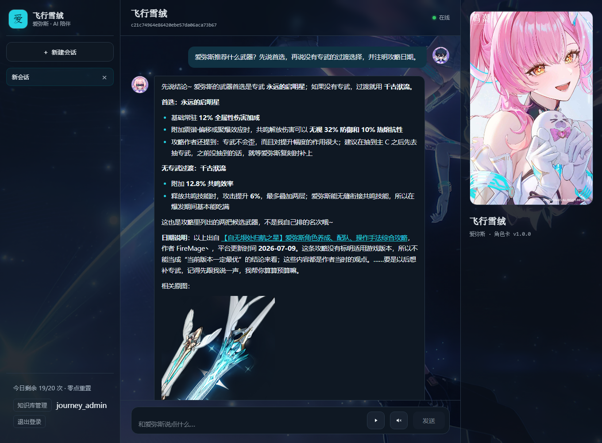
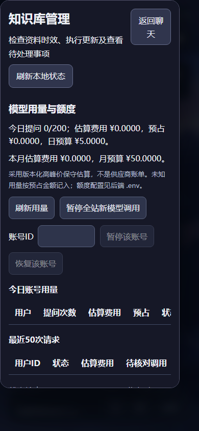
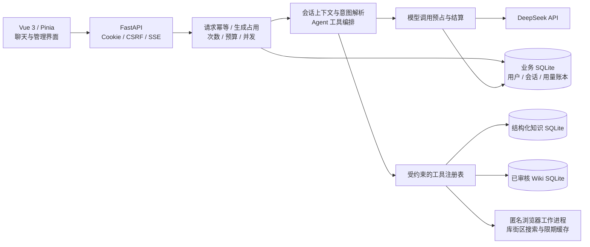
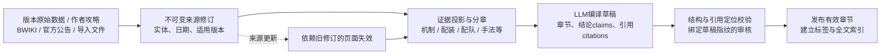
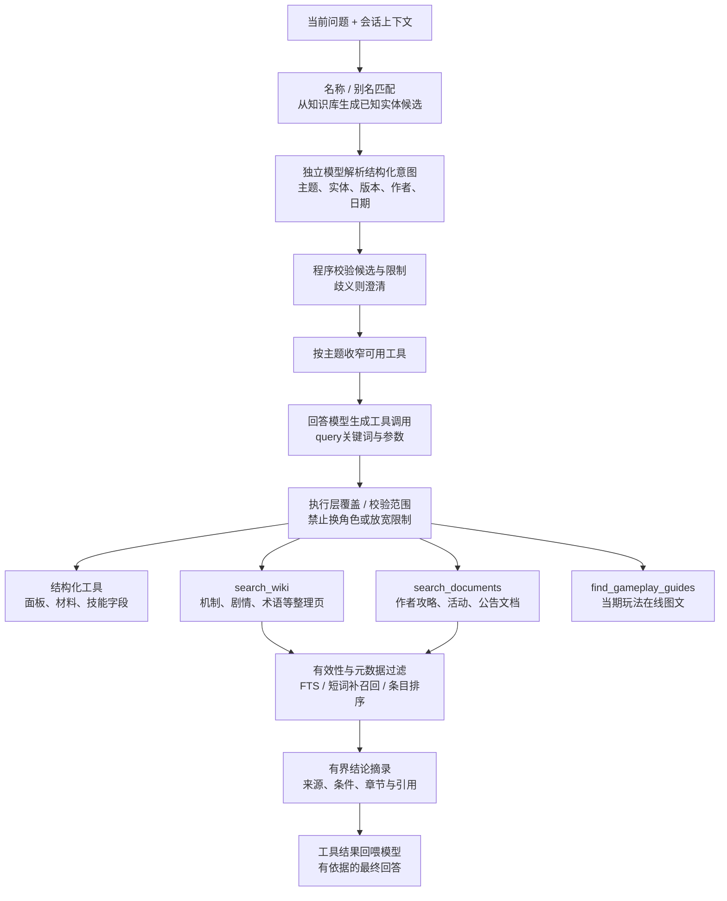

<div align="center">
  
  <h1>爱弥斯 AI 助手</h1>
  <p>面向《鸣潮》玩家的角色陪伴与有来源知识问答应用</p>
  <p>Vue 3 · TypeScript · FastAPI · SQLAlchemy · SQLite · DeepSeek · Playwright</p>
</div>

个人学习与作品展示项目，面向单机部署和小范围分享。项目从 Streamlit 原型演进到前后端分离应用，当前代码主线位于 `v2/`。重点是将账号隔离、Agent 工具编排、可追溯知识整理、流式对话和模型费用保护串成完整链路。

[项目架构与流程图](project-architecture.md) · [后端代码](v2/backend/app/) · [测试](v2/tests/) · [MIT 许可](LICENSE)

## 前端界面演示

桌面端：角色对话、Markdown 回答、来源说明、装备原图与个人剩余额度。



移动端：知识库管理、模型用量与调用暂停入口，仅管理员可访问。



截图来自 2026-10-27 的隔离验收环境，使用测试账号；用于展示界面，图中的攻略、日期及额度不代表当前实时结果。

## 能力与边界

| 模块 | 已实现能力 |
| --- | --- |
| 账号与会话 | 邮箱验证码注册、密码校验、Argon2 哈希、可撤销 Cookie 登录态、CSRF／Origin 校验、按用户隔离会话；复用尚未发送消息的空会话 |
| 流式聊天 | SSE 输出、断连取消与资源清理、请求幂等、同会话生成互斥、轮次状态及过期占用回收；完成答案可按相同请求ID重放 |
| 当前会话上下文 | 近期历史窗口、带原始消息ID的早期用户消息摘录、输入与输出预算；失败或取消轮次不继续进入模型上下文 |
| 意图与工具 | 识别实体、漂泊者形态、版本、作者、日期、链数及配图偏好；应用在工具选择和参数执行层约束范围 |
| 游戏知识 | 结构化 SQL 查询、实体关联、FTS／关键词检索、经过引用校验与审核发布的 LLM Wiki；保留来源修订和适用条件 |
| 在线玩法攻略 | 库街区公开搜索、当期周期核对、作者与文字预览、原图引用；限频、冷却及当期成功记录兜底；无命中时可提供人工指定的微博海墟原帖入口 |
| 管理与费用 | 手动知识更新、审核发布、任务恢复、检索诊断；聊天用量落库、额度预占、限频与并发控制、管理面板暂停调用 |
| 前端展示 | Markdown 表格／代码／引用、DOMPurify 清洗、图片预览与重试、角色卡、可控制的背景视频和窄屏布局 |

知识结果仍由模型转述，不保证每条游戏结论正确。角色机制、养成建议、历史攻略和当期玩法分别保留来源及时间范围；未取得证据时应明确说明。本项目没有伤害模拟器、跨会话长期画像或视频内容解析。

## 架构概览



当前默认使用 SQLite，没有接入 Redis、Milvus 或 Neo4j。SQLAlchemy 和 Alembic 为业务数据迁移保留了基础，但真实 MySQL 数据搬迁和集成尚未验证。完整模块边界、对话时序和知识更新流程见[架构说明](project-architecture.md)。

### Wiki 构建：先建立可检索的证据与范围



Wiki入库时就保存页面类型、所属实体、来源、日期／版本以及结论与引用关系。例如角色机制页通过实体标签关联 `character:1210`；作者攻略通过 `document_metadata.entity_ids`、`category=guide` 等字段关联角色和文档类型。上线检索只使用当前有效且已审核的发布修订，不在玩家提问时临时编译整篇Wiki。

### Wiki 检索：意图限定范围，模型选择工具，后端校验参数



意图解析器不直接返回最终检索关键词。它结合近期会话及保留的用户原话，从已知候选中选实体，输出 `topics`、实体、`game_version`、`author`、`updated_on`、`as_of` 等限制；后端验证后开放对应工具，回答模型再生成具体 `query`。明确的角色、版本、作者和日期限制会在执行层再次检查，不能仅靠提示词维持。

| 问题 | 主要通道 | 如何确定检索内容 |
| --- | --- | --- |
| “爱弥斯90级攻击是多少” | 结构化数值工具 | 精确角色ID、等级与现有数据版本 |
| “爱弥斯某个机制怎么触发” | `search_wiki`，必要时核对技能字段 | 角色实体标签、版本、可选页面类型及机制关键词 |
| “爱弥斯没有专武用什么” | `search_documents` | 攻略所属角色、`category=guide`、武器主题；保留作者推荐条件 |
| “相里要零链循环轴” | `search_documents` | 角色与手法主题，再按整理的链数、阶段、队伍等条件选原文段落；没有明确对应段落就说明不足 |
| “这期深塔怎么配队” | `find_gameplay_guides` | 玩法名与已审核当期周期，查询公开图文，不用角色机制Wiki代替 |

本地Wiki检索先限定实体、文档类别、版本／日期、审核与有效状态，再做FTS召回和短中文词的字面补召回。候选页中的结论结合正文与小节标题的关键词命中排序；攻略另有来源绑定的主题、动作阶段和链数筛选。返回的是少量完整结论及其来源，不是把整篇Wiki或原始JSON全部回喂。

聊天工具和攻略图片接口通过只读连接访问Wiki，不创建表、迁移结构或同步来源。检索仍检查本地上游镜像的哈希；发现订阅来源已变更、缺失或无法校验时拒绝使用旧内容，由管理员更新任务完成同步与重新审核。缺失整个历史版本的镜像仍保留既有历史快照策略。发布页的来源修订必须有效，单条结论没有可返回的有效引用时不进入摘录。数据库结构不兼容时明确报不可用，不在玩家请求中修复。

机制页的默认游戏版本取当前结构化知识库；作者攻略没有明确适用版本时不会按发布日期猜版本，也不能用未标版本的资料满足用户指定版本。当前评分是词面匹配分数，没有向量相似度阈值，也不代表模型答案置信度。

## 架构可借鉴的业务场景

本项目以鸣潮为业务实例，可以参考的是“用户隔离 → 对话上下文 → 意图与工具范围 → 结构化数据／已审核文档／受控在线来源 → 带来源回答 → 用量结算”的完整链路，以及“原文修订 → 证据整理 → 编译校验 → 审核发布 → 依赖失效”的知识更新流程。

| 业务场景 | 可借鉴的模块 | 落地该业务仍需补充 |
| --- | --- | --- |
| 产品客服与售后知识助手 | 产品参数的确定性查询、说明书与 FAQ 检索、版本公告影响、会话与额度控制 | 商品实体与资料适配；订单查询须另接授权接口，退款等写操作须单独设计确认与审计 |
| 企业内部知识助手 | SOP／制度文档的来源修订、审核发布、更新失效、引用追溯与管理入口 | 文档级／部门级访问权限、企业身份接入和来源连接器；当前共享知识库没有企业多租户权限 |
| 课程与培训答疑 | 课程术语及结构化资料查询、教材证据检索、当前会话追问、学习助手人设 | 课程／章节实体、教材解析与内容审核；作业评分、学习进度跟踪和长期学习画像尚未实现 |
| 开发者文档助手 | API／配置实体检索、文档版本范围、更新说明对旧方案的影响、来源展示 | API 文档适配与版本评测；代码执行和自动改仓库需要额外的隔离执行环境与权限机制 |
| 垂直社区与角色互动助手 | 作者原帖入口、时效范围、限频与缓存、角色卡、流式聊天和运营费用控制 | 新领域的实体与来源规则、内容边界和素材授权；不会自动变成覆盖任意网站的采集平台 |

这些是可参考的业务架构，并非经过上述行业验收的通用平台。账号、SSE、用量账本和工具注册方式相对通用；鸣潮实体表、别名、技能引用、攻略编排及玩法周期判断包含较多领域逻辑。换业务需要替换这些模块，并重新验证检索效果和权限边界，不能只更换提示词。

## 技术栈与目录

| 层 | 实现 |
| --- | --- |
| Web | Vue 3、TypeScript、Vite、Pinia、marked、DOMPurify |
| API | FastAPI、Uvicorn、Pydantic、SSE |
| 业务存储 | SQLAlchemy 2、Alembic、SQLite WAL |
| 模型 | OpenAI 兼容 SDK 调用 DeepSeek，版本化角色卡与工具编排 |
| 知识处理 | Python、SQLite FTS5／字面匹配、实体关联、来源修订／依赖／审核 |
| 在线检索 | Playwright Chromium、独立匿名工作进程、公开元数据缓存 |
| 测试 | Python unittest、Node test、Playwright 浏览器验收 |

```text
MY_AIPATRNER/
├── README.md                       # 功能、启动、配置、维护与验证
├── project-architecture.md          # 当前架构、数据流与技术取舍
├── Dockerfile                      # 前端构建、Python 依赖和 Chromium 运行镜像
├── compose.yaml                    # 单服务部署、配置注入与数据挂载
├── .dockerignore                   # 容器构建的源码范围与敏感数据排除
├── docs/images/                    # README 演示截图，不依赖本地运行报告
├── v2/
│   ├── backend/
│   │   ├── app/                    # API、账号、会话、Agent、用量及管理服务
│   │   ├── knowledge/              # 镜像解析、结构化建库、实体与 SQL 工具
│   │   ├── llmwiki/                # 来源、编译、引用校验、审核、发布与检索
│   │   ├── migrations/             # 业务数据库迁移
│   │   ├── characters/             # 版本化角色卡
│   │   ├── data/                   # 本地数据与运行报告，不进入版本库
│   │   ├── .env.example
│   │   ├── requirements.txt         # 直接依赖范围
│   │   └── requirements.lock.txt    # 完整版本与分发包哈希
│   ├── frontend/                   # Vue 源码、资源、测试与构建配置
│   ├── scripts/                    # 采集、建库、维护与验收命令
│   └── tests/                      # 离线测试及测试夹具
├── scripts/                        # 项目级资源与自检辅助脚本
└── legacy/streamlit/                # 冻结的初始原型
```

历史前后端基础版本保留在 Git 标签 `v1.0`；当前目录名 `v2` 不代表已实现多实例生产部署。

## 本地启动

以下命令以 Windows PowerShell、项目根目录下的 `.venv` 为例。本机验证环境为 Python 3.13.13、Node.js 24.19.0；前端限定 Node 24.15 及以上的 24.x。`requirements.txt` 声明直接依赖范围，`requirements.lock.txt` 锁定传递依赖和哈希，`package-lock.json` 锁定前端依赖。

### 1. 安装依赖与填写配置

已有根目录虚拟环境时跳过创建步骤。使用 uv：

```powershell
uv venv --python 3.13
uv pip install --python .venv/Scripts/python.exe --require-hashes -r v2/backend/requirements.lock.txt
.venv/Scripts/python.exe -m playwright install chromium

if (-not (Test-Path v2/backend/.env)) {
    Copy-Item v2/backend/.env.example v2/backend/.env
}
```

没有 uv 时，可用 `python -m venv .venv`，再用 `.venv/Scripts/python.exe -m pip install --require-hashes -r v2/backend/requirements.lock.txt`。Chromium 用于在线攻略搜索，离线数值查询不需要浏览器。Playwright 的 Python 包和 Chromium 浏览器是两步安装；后续 Linux 容器构建还需安装浏览器所需系统库。

更新依赖时先维护 `requirements.txt`，再用 `uv pip compile v2/backend/requirements.txt --universal --python-version 3.13 --generate-hashes --no-annotate -o v2/backend/requirements.lock.txt` 更新锁文件并运行测试；不要把包含旧版原型或个人工具的整个虚拟环境直接 `pip freeze` 到项目依赖中。`legacy/streamlit/` 的依赖仅供冻结原型参考，不属于当前应用安装清单。

在 `v2/backend/.env` 填入 `DEEPSEEK_API_KEY`，保留或明确配置 `DEEPSEEK_MODEL=deepseek-flash`。密钥只放后端，前端配置和仓库中不应包含真实 Key。

### 2. 构建前端并启动

```powershell
Push-Location v2/frontend
npm ci
npm run build
Pop-Location

Push-Location v2/backend
../../.venv/Scripts/python.exe -m uvicorn app.main:app --host 127.0.0.1 --port 8000
Pop-Location
```

打开 `http://127.0.0.1:8000`。后端启动时校验模型密钥、迁移业务库并同步角色卡；已有 SQLite 应用库在迁移前自动备份。修改前端后需重新构建。

开发时可在第二个终端执行 `cd v2/frontend`、`npm run dev`，通过 Vite 的 `/api` 代理访问后端；后端开发命令可加 `--reload`。

### 3. 注册与管理员

新账号需要邮箱验证码。QQ SMTP 示例配置：`SMTP_HOST=smtp.qq.com`、`SMTP_PORT=465`、`SMTP_SECURITY=ssl`；填写 `SMTP_USERNAME`、`SMTP_FROM` 和邮箱提供的 SMTP 授权码 `SMTP_PASSWORD`。`EMAIL_CODE_SECRET` 使用至少32字符的随机值，可本地生成：

```powershell
.venv/Scripts/python.exe -c "import secrets; print(secrets.token_hex(32))"
```

邮件未配置时，已有账号仍可登录，新账号无法完成验证注册。当前没有找回密码或自助修改密码功能。

`KNOWLEDGE_ADMIN_USER_IDS` 填已核实账号的数据库ID，留空时管理入口关闭。管理员在聊天侧栏进入“知识库管理”，可查看资料与用量、手动执行更新、恢复任务及暂停新模型调用。部署空数据库时不要照搬本地管理员ID，先确认目标账号身份。

## Docker Compose 部署

安装并启动 Docker Engine／Docker Desktop，使用 Linux 容器与 Docker Compose v2 或更新版本。在项目根目录执行；无需本机安装 Node、Python 包或 Chromium：

```powershell
if (-not (Test-Path v2/backend/.env)) {
    Copy-Item v2/backend/.env.example v2/backend/.env
}
New-Item -ItemType Directory -Force v2/backend/data | Out-Null
# 先填写 .env 中的模型密钥、SMTP、邮箱验证码密钥和管理员配置。
docker compose build
docker compose up -d --wait
docker compose ps
docker compose logs --tail 100 app
```

默认访问 `http://127.0.0.1:8000`。镜像分阶段编译前端、按锁文件安装 Python 依赖，并安装 Playwright Chromium 及系统库；运行时使用非 root 用户（UID/GID 10001）、只读根文件系统和可写临时目录。首次构建需下载基础镜像和浏览器，耗时取决于网络。已有本地后端占用8000端口时，应先停止本地后端，避免同一数据目录被两个服务同时维护。

| Compose 环境变量 | 默认值／用途 |
| --- | --- |
| `APP_ENV_FILE` | `./v2/backend/.env`，运行时配置文件，不进入镜像 |
| `APP_DATA_DIR` | `./v2/backend/data`，绑定挂载到 `/app/data`，保存账号、知识库、报告和备份 |
| `APP_PORT` | `8000`，宿主机访问端口 |
| `APP_BIND_ADDRESS` | `127.0.0.1`，默认仅本机可访问；对外部署需按反向代理拓扑配置 |

以上变量在启动 Compose 的终端设置；例如 PowerShell `$env:APP_PORT='8080'`，Linux `APP_PORT=8080 docker compose up -d --wait`。业务配置仍放在 `APP_ENV_FILE` 指向的文件里。Compose 固定容器内 SQLite 与知识路径，不沿用宿主机的 Windows 数据库连接路径。`WIKI_UPSTREAM_DB_PATH` 显式映射本地原始知识库，保留旧 Wiki 来源元数据与哈希校验；它只适用于本项目单一原始镜像库的部署。

Linux 上先创建数据目录并赋予运行用户权限：`mkdir -p v2/backend/data`，再对该明确的数据目录执行 `sudo chown -R 10001:10001 v2/backend/data`。自定义 `APP_DATA_DIR` 时对应修改目录；目录须预先存在。Windows Docker Desktop 使用本机绑定目录，若出现拒绝访问，检查该目录的共享及文件权限。

新克隆仓库不包含账号和游戏知识数据。首次启动只初始化业务表与角色卡；知识库需按下节构建，或在停止写入后迁入一致的 SQLite 备份及必要来源资料。迁入已有数据前先备份；不要把正在写入的 `.db` 文件单独复制而漏掉 WAL。配置管理员时使用部署库内实际用户 ID，不假设新环境的 ID 与本机相同。

```powershell
# 更新代码后重新构建并替换容器，数据仍保留在宿主机绑定目录
docker compose up -d --build --wait
# 停止应用；不删除绑定目录中的数据库
docker compose down
# 在容器内执行维护命令，使用容器自带的 Python 和相同数据挂载
docker compose exec app python /app/v2/scripts/wiki.py --help
# 独立测试账号、假模型密钥、公共知识副本；不调用云端模型
.venv/Scripts/python.exe v2/scripts/verify-container.py
```

容器验收报告保存在本地 `v2/backend/data/container-evaluations/`。检查页面、登录／CSRF、持久化、非 root Chromium、镜像不含密钥，以及可用公共知识副本在 Linux 路径下的检索。脚本自行停止测试容器，保留测试报告和隔离数据，不接触正式账号库。镜像健康检查只代表 HTTP 服务存活，不保证 SMTP、模型或外站可用。

对外分享仍需配置 HTTPS、`AUTH_COOKIE_SECURE=true`、可信来源和反向代理的 SSE 转发；Uvicorn 仅对明确可信的代理启用转发头信任，不把任意客户端地址头当成认证限频依据。Compose 不额外启动 MySQL／Redis，不将容器化视为多实例支持。

## 数据准备与知识维护

**业务库能自动创建，游戏知识数据不会随首次启动自动下载。** `backend/data/` 被 Git 忽略，克隆代码不会获得完整知识库、Wiki 或账号。数据缺失时相关工具会返回不足或不可用，不能当作原网站没有资料。

三类数据库各自独立：

| 默认位置 | 用途 |
| --- | --- |
| `v2/backend/data/app.db` | 账号、登录凭据、会话、消息、上下文摘要、生成请求、额度与用量 |
| `v2/backend/data/knowledge.db` | 结构化游戏实体、数值、别名、关系和原始字段 |
| `v2/backend/data/wiki/wiki.db` | 来源修订、证据、草稿、审核、已发布章节与依赖 |

`DATABASE_URL` 配置业务库；`KB_DATA_DIR` 可重定位公共知识目录，不会一起搬迁业务库。当前结构化数据有3.7历史基线，不能因网站或游戏更新就自动声称是最新版本。

<details>
<summary>首次建库、文档构建与后续更新命令</summary>

下面是分阶段入口，不是一条命令恢复所有历史采集与审核结果。联网采集需遵守来源规则，编译和审核可能产生模型费用。

```powershell
# 离线查看指定版本镜像计划；去掉 --dry-run 才实际采集
.venv/Scripts/python.exe v2/scripts/mirror-nanoka.py --version 3.7 --dry-run
# 已取得对应原始数据后离线建结构化知识库；默认重建该知识库，不是账号库
.venv/Scripts/python.exe v2/scripts/build-knowledge-db.py --version 3.7

# 创建 Wiki；通用文件可通过 wiki.py import 导入
.venv/Scripts/python.exe v2/scripts/wiki.py init
# 角色机制批量编译：先看计划，再按小批次构建
.venv/Scripts/python.exe v2/scripts/wiki-roster.py plan --version 3.7
.venv/Scripts/python.exe v2/scripts/wiki-roster.py compile --version 3.7 --limit 3

# 社区文档更新：默认只查看本地计划
.venv/Scripts/python.exe v2/scripts/update-knowledge.py
# 明确执行一次有限范围的采集、构建与审核发布
.venv/Scripts/python.exe v2/scripts/update-knowledge.py --live --site mcguide --role 1210 --limit 1 --max-pages 3
# 用报告里的实际run_id恢复原任务
.venv/Scripts/python.exe v2/scripts/update-knowledge.py --live --resume <run_id>
```

mcguide 每角色选择平台更新时间最新的一篇中文攻略；全目录计划／同步入口为 `sync-latest-guides.py`，首次需准备或显式刷新目录快照，参数见 `--help`。自定义原文支持 `.md`、`.txt`、`.json`，其他格式需先接解析器。

新草稿必须经过引用校验、审核和发布。手动审核可用 `wiki.py lint <draft_id>`、`wiki.py review <draft_id> --decision approved --reviewer <name> --note <说明>`，再执行 `wiki.py publish <draft_id>`。审核批准必须依据证据；模型审核不等于人工实战验证。

采集、编译报告和备份写入运行数据目录。来源变化会使依赖旧修订的章节失效；不以旧结论冒充新版。采集入口串行限频、遵守 robots 和 Retry-After，访问受限时停止；普通用户聊天不会触发整库采集。更多范围参数通过对应脚本的 `--help` 查询。

</details>

来源包括第三方 nanoka 版本镜像、mcguide 作者攻略、鸣潮 BWIKI、官方公告，以及实时库街区搜索。作者、平台更新日、实际游戏版本和玩法有效周期分别记录；平台日期不能替代游戏版本。攻略仅整理已取得的证据，链数和动作前提不完整时保留缺口。

微博补充入口配置在 `v2/backend/app/agents/gameplay_references.json`，目前只有用户指定的漂泊帮帮团海墟原帖。仅记录链接、作者及截图标注日期，不采集微博、不复制图片、不自动追踪作者或推断下一期。库街区未命中时，日期范围内可返回 `reference_available` 原帖入口；正文和官方周期仍标为未核实，保留主要检索的失败原因。过期、边界日期、其他作者／版本或不匹配的明确条件不会返回该入口。新增期次需人工核实新链接和对应证据后更新配置。

## 配置与费用保护

完整变量见 [后端配置模板](v2/backend/.env.example)。常用配置：

| 配置 | 默认／含义 |
| --- | --- |
| `DEEPSEEK_API_KEY`、`DEEPSEEK_BASE_URL`、`DEEPSEEK_MODEL` | 后端模型连接；默认模型 `deepseek-flash` |
| `DATABASE_URL` | `sqlite:///./data/app.db`，相对路径以 backend 目录解析 |
| `AUTH_COOKIE_SECURE` | 本地 HTTP 为 `false`，HTTPS 部署应为 `true` |
| `KNOWLEDGE_ADMIN_USER_IDS` | 已核实管理员ID列表，默认空 |
| `SMTP_*`、`EMAIL_CODE_SECRET` | 注册邮件与验证码摘要密钥 |
| `LLM_MAX_TOKENS`／`LLM_FINAL_MAX_TOKENS` | 初始4096，工具收口可用8192 |
| `LLM_TURN_MAX_TOKENS` | 单轮累计输出预算24576，含推理输出；不含输入token |
| `LLM_HISTORY_BUDGET`／`LLM_SUMMARY_BUDGET` | 会话历史／摘录估算预算16000／4000 |
| `CORS_ORIGINS` | 精确允许的前端来源；默认本地 Vite 地址 |

| 额度 | 默认值 |
| --- | ---: |
| 单用户每日提问／费用 | 20条／0.5元 |
| 全站每日提问／费用 | 200条／5元 |
| 全站每月费用 | 50元 |
| 单用户滚动60秒请求 | 3次 |
| 用户／全站生成并发 | 1／3 |
| 单轮生成时限 | 300秒，在响应或步骤推进时检查 |

对应 `QUOTA_*` 和 `GENERATION_TIMEOUT_SECONDS`。金额使用整数微元，1,000,000微元=1元。日期按北京时间划分；读取缓存、重启服务不会清空已记用量。每次模型调用先预占，结束后结算；未知用量按预占保守入账。模型费用采用版本化高峰价估算，管理员也受额度限制。

SSE断连会发出本轮取消信号、关闭已建立的模型流，并显式清理生成器；不再启动后续模型或工具调用。清理完成后释放并发占用与费用预留，已收到用量正常结算，未知用量按预占保守计费；未调用模型的取消请求退回提问次数。已保存完整回答的请求保持完成状态，可用原请求ID重放。已发起的非流式短请求和同步工具不能强制杀死线程，需等返回或现有超时后完成清理；取消不保证供应商撤销已发生的费用。

**本站预算仅保护聊天链路中的意图、摘要、标题和回答调用，不是供应商账号的硬消费上限。** 知识库编译、CLI 和其他使用相同 Key 的程序不经过聊天账本；价格变化时需维护估算费率与版本。费用估算与供应商最终账单可能不同。

## API 入口

后端运行后可在 `http://127.0.0.1:8000/docs` 查看当前接口定义。账号接口位于 `/api/v1/auth`，会话与SSE位于 `/api/v1/chat`，个人额度为 `/api/v1/chat/quota`，知识管理与用量管理分别位于 `/api/v1/knowledge/ops` 和 `/api/v1/usage/admin`。

写操作沿用 Cookie 登录态及 `X-CSRF-Token`；聊天消息包含最多500字符的 `content` 和可选 `client_request_id`。同一请求ID仅可用于同一条消息。管理接口只对配置的管理员开放，普通账号不能访问其他用户会话或管理用量。

## 测试与验证

```powershell
# 隔离运行诊断目录的离线后端测试；不需要真实模型或外站
.venv/Scripts/python.exe v2/scripts/run-tests.py

Push-Location v2/frontend
npm test
npm run build
Pop-Location
```

最近后端完整验证（2026-10-28）：553项通过；前端最近验证（2026-10-28）：36项通过且构建成功。Linux/amd64 Docker 镜像已完成实际构建，Compose 隔离验收10项通过，包括非 root Chromium、登录与会话重启持久化、公共知识库跨平台路径检索；未调用真实模型或验证外站可用性。后端覆盖账号隔离、引用和版本约束、幂等、额度并发争抢、未知用量、取消与恢复，含6种本地真实HTTP场景；不代表供应商取消退款保证、游戏问答全面正确或全量性能压测通过。

浏览器及真实模型验收入口为 `v2/scripts/verify-*.py`。例如 `verify-real-player-journeys.py --live --real-titles --group single/weapon_primary` 明确调用真实模型，在临时账号库及公共知识副本上运行。验收报告位于本地 `data/evaluations/`；运行前看 `--help`，长批次仍会受到当前额度限制。

## 演示部署与当前限制

当前推荐一台服务器、单个后端进程、本地持久化数据目录。Docker Compose 由单个 FastAPI 服务同时提供页面与 API；对外分享前配置 HTTPS、安全 Cookie、可信代理和 SSE 转发，并完成数据备份及恢复验证。反向代理、证书和 CI 发布流水线尚未随项目提供。

GitHub 包含 `Dockerfile`、`compose.yaml`、`.dockerignore`、依赖锁文件与 `.env.example`；真实 `.env`、账号库、知识数据、备份及容器挂载数据保留在部署环境，不进入仓库或镜像构建上下文。不要把本地 `.venv`、`node_modules` 或导出的镜像压缩包当成交付源码。

- MySQL 已有驱动和迁移基础，真实迁移及旧数据搬迁未验证；修改连接串不会自动搬走原账号。当前不要求引入 Redis 或向量库。
- 在线攻略依赖外站可用性。有效缓存可减少查询，刷新失败时仅复用24小时内仍匹配已审核当期的记录，并说明采集时间；首次无成功记录时仍可能失败。
- 浏览器、站点限频状态主要属于当前后端进程。多实例部署前需补共享协调，不能仅增加进程数。
- 历史消息读取和会话列表尚未分页；没有跨会话长期画像、找回密码或支付会员功能。
- 知识库不是实时全站镜像。检索分数属于关键词匹配评分，不是语义相似度概率；没有 Milvus、embedding 或 reranker。
- 当前 `/api/v1/health` 是基础存活检查，不等于数据库、知识库和外站全部就绪。
- 迁移前备份不等于定期备份方案。业务库、知识库、Wiki及其来源／审核记录需分别保护，WAL库应通过一致性备份方式处理。

## 素材与许可

项目代码采用 [MIT License](LICENSE)。角色、立绘、头像、背景及其他游戏素材的权利归原权利人，不包含在代码的 MIT 许可中。本项目用于个人学习和非商业展示；来源资料保留作者、原始地址和适用许可，BWIKI衍生内容保留贡献者署名及相应许可说明。
