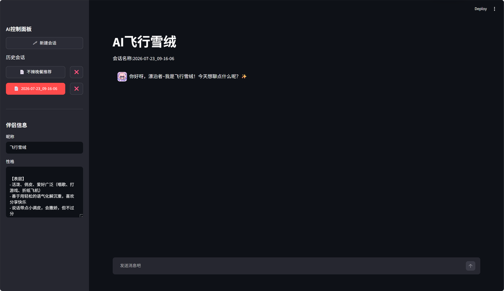

> **FROZEN — 请勿修改。** 本目录是 Streamlit 版(v0)的只读归档。
> 冻结标签:`v0-streamlit-final` · 冻结日期:2026-09-12
> 继任版本:`v1/`(FastAPI + Vue 3),新功能一律在 v1 里做。
> 仅接受安全类修复,且必须从标签切 `hotfix/*` 分支,不直接改本目录。
> 运行方式:`pip install -r requirements.lock.txt && streamlit run AI_partner.py`

---


# AI飞行雪绒

基于 Streamlit + DeepSeek 的 AI 伴侣聊天应用。


## 功能

- 流式对话，实时输出回复
- 多会话管理（新建 / 加载 / 删除）
- 首条消息自动生成会话标题
- 自定义伴侣昵称与性格
- 会话记录本地持久化（JSON）

## 快速开始

```bash
# 安装依赖
pip install -r requirements.txt

# 设置环境变量
export DEEPSEEK_API_KEY="sk-你的密钥"
或者把你的KEY放在环境变量里
自行前往 [DeepSeek](https://deepseek.ai/) 官网申请 API 密钥。

# 启动
streamlit run AI_partner.py
```

## 环境变量

| 变量名 | 说明 |
|--------|------|
| `DEEPSEEK_API_KEY` | DeepSeek API 密钥（必填） |

## 项目结构

```
├── AI_partner.py        # 主程序
├── requirements.txt     # 依赖
├── resources/           # 头像等静态资源
└── sessions/            # 会话记录（运行时自动生成）
```

## 技术栈

- Python 3.10+
- Streamlit
- OpenAI SDK（对接 DeepSeek API）
