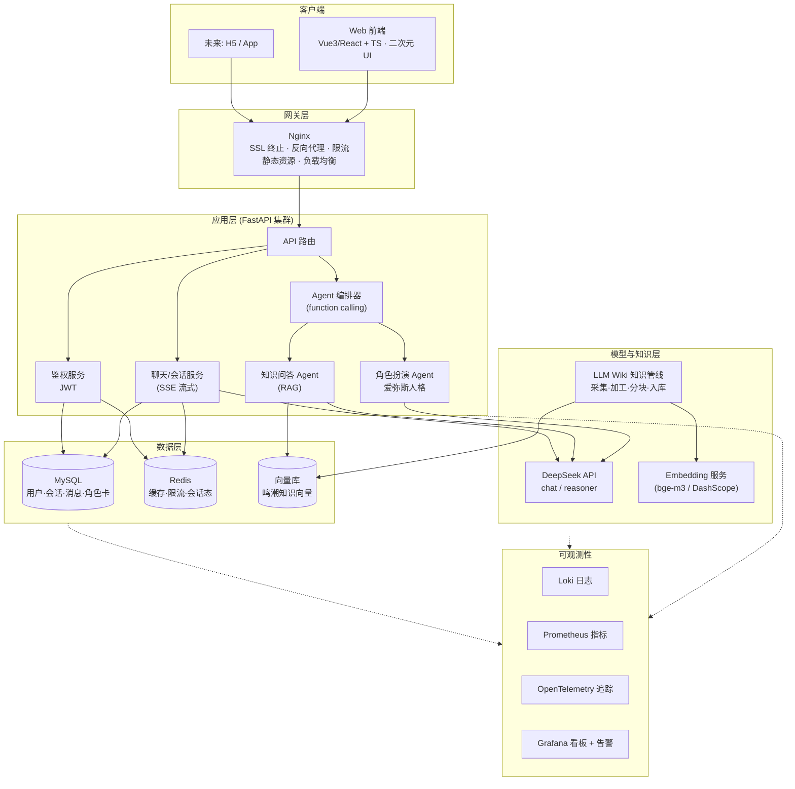

# 《鸣潮》爱弥斯 AI 助手 · 项目架构与迭代蓝图

> 版本 v1.0 · 基于对 `AI_partner.py`、`README.md`、`requirements.txt` 的代码审计整理
>
> **一句话摘要**：把当前「单文件 Streamlit 角色扮演脚本」演进为「二次元前端 + FastAPI Agent 后端 + RAG 知识库 + MySQL/向量库 + Nginx 网关 + 阿里云部署 + 全链路可观测」的分层可扩展服务。

---

## 1. 现状盘点（审计结论）

### 1.1 现有技术栈

| 项 | 现状 |
|---|---|
| 入口 | `streamlit run AI_partner.py`（单文件，约 290 行） |
| LLM | OpenAI SDK → DeepSeek（`base_url=https://api.deepseek.com`，模型 `deepseek-v4-pro`） |
| 会话存储 | 本地 JSON 文件（`sessions/*.json`） |
| 资源 | `resources/feixingxuerong.png`（爱弥斯头像）、`resources/piaobozhe.jpg`（漂泊者头像） |
| 依赖 | `requirements.txt` 仅 `streamlit` + `openai` |

### 1.2 已具备、可保留的能力

| 能力 | 实现 | 迁移判断 |
|---|---|---|
| 流式对话 | `stream=True` 逐字渲染 | ✅ 核心逻辑直接复用 |
| 多会话管理 | 新建/加载/删除 + JSON 持久化 | ⚠️ 改为数据库 + 多用户 |
| 会话标题 | 首条消息让 LLM 生成标题 | ✅ 复用，下沉为后端服务 |
| 角色扮演 | `system_prompt` 硬编码爱弥斯人设 + 昵称/性格可编辑 | ⚠️ 人设需「角色卡」版本化 |
| 头像 | 本地图片 | ✅ 迁到对象存储/CDN |

### 1.3 关键缺口（架构演进动因）

1. **无前后端分离** —— UI 与逻辑耦合在 Streamlit，无法实现「爱弥斯风格二次元页面」。
2. **无知识库 / RAG** —— 鸣潮知识（剧情、玩法、更新、配队）全靠模型参数记忆，易过时、易幻觉、无来源引用。
3. **无多用户 / 鉴权** —— 本地 JSON 存储，无法公网多人使用。
4. **无网关 / 限流 / 负载均衡** —— 公网暴露与水平扩展无从谈起。
5. **无可观测性** —— 仅 `print()`，上线后等于「盲飞」。
6. **模型名硬编码** `deepseek-v4-pro` —— 迁移时需与 DeepSeek 官方可用模型（`deepseek-chat` / `deepseek-reasoner` 等）核对，并下沉为配置项。
7. **无内容安全** —— 输入/输出无敏感过滤、无速率限制。

### 1.4 保留资产清单

- 爱弥斯人设文案 → 转成版本化的「角色卡」（`characters` 表 + 独立 `role_card.md`）
- 流式对话 + 会话标题生成逻辑 → 迁入 FastAPI 服务
- 两张头像 → 上传阿里云 OSS，走 CDN

---

## 2. 目标愿景

- **定位**：《鸣潮》垂直领域的「爱弥斯」AI 陪伴 + 知识问答助手。
- **双能力**：
  - **陪伴**：延续爱弥斯人格角色扮演（活泼俏皮、家人羁绊、隐藏悲伤）。
  - **知识**：权威鸣潮知识问答（剧情、玩法、版本更新、配队攻略），由「LLM Wiki 知识库 + RAG」保证**准确、可溯源、可随版本增量更新**。
- **产品形态**：Web 优先（二次元画风），后端接口为未来 H5 / App 预留。
- **非目标（本期不做）**：实时语音、多人聊天室、付费墙、精确数值模拟器。

---

## 3. 总体架构



### 3.1 建议的代码仓库结构（monorepo）

```text
wuthering-amis/
├── frontend/            # 前端: Vue3/React + TS
│   └── src/{pages, components, stores, api, styles}
├── backend/             # 后端: FastAPI
│   └── app/{api, core, agents, services, models, schemas}
├── knowledge/           # LLM Wiki 知识管线
│   └── {crawler, pipeline, scripts}
├── deploy/              # nginx 配置 + docker-compose
├── observability/       # prometheus / loki / grafana / otel 配置
├── docs/                # 架构、API、知识库规范
└── legacy/              # 冻结的 AI_partner.py 与 sessions/
```

---

## 4. 分层设计（对应你的 7 个迭代点）

### 4.1 前端（迭代点 1）—— 二次元「爱弥斯风格」UI

**目标**：React / Vue 3 + TypeScript，构建参考鸣潮美学的二次元聊天页面与配套页面。

**视觉方向（锁定后 Phase 1 再细化为设计令牌）**

- **基调**：末世科幻 + 国风留白 + 全息 HUD，呼应鸣潮的「科技感、细描边、呼吸光效」。
- **色彩**：深空藏青/近黑底 + 青蓝科技主强调色 + 爱弥斯机兵形态的银白荧光点缀，少量品红/紫用于能量/声骸反馈。（精确 OKLch 令牌在 Phase 1 从官方素材提取，不拍脑袋写死。）
- **字体**：标题用带国风感的衬线/特制字，正文黑体，数值/版本号用等宽。
- **关键元素**：爱弥斯立绘（Live2D，官方素材）、玻璃拟态卡片、细描边 HUD、粒子/呼吸光效、消息气泡流式渲染。
- **参考信息架构**：二游官网角色专题页 + bilibili 攻略站 + 同人站的「角色卡 + 对话 + 知识库」三段式。

**页面清单（首版）**

1. `chat` 聊天页（核心）：会话列表 + 消息流 + 爱弥斯 Live2D + 输入框。
2. `knowledge` 知识库页：剧情 / 玩法 / 更新 / 配队攻略 分类浏览与检索。
3. `characters` 角色页：角色卡、立绘、资料。
4. `settings` 设置页：昵称、性格、模型参数、会话管理。

**版权约束（硬性）**：爱弥斯立绘、鸣潮 UI 素材受版权保护，只使用官方公开素材（官方 Wiki 立绘、官方公告图）并标注来源，**不生成/绘制「仿冒」立绘**。

**技术选型（见 §5.1）**：推荐 Vue 3 + TypeScript + Vite + Pinia，React 为对等备选。

### 4.2 网关与负载均衡（迭代点 3）—— Nginx

- **职责**：SSL 终止、静态资源与前端托管、反向代理 `/api/*` 与 `/ws/*`、限流（`limit_req`）、WebSocket/SSE 升级、灰度/加权负载均衡到 FastAPI 实例。
- **要点**：
  - SSE 流式需关闭 `proxy_buffering`，否则流式会被缓冲成一次性输出。
  - 登录/生成接口单独限流（如 `limit_req_zone $binary_remote_addr`）。
  - 静态立绘/前端走 CDN，Nginx 只做回源。

### 4.3 后端（迭代点 2）—— FastAPI + Agent 工具接口

- **框架**：FastAPI + Python 3.11+，`uvicorn` 多 worker（或 gunicorn + uvicorn worker）。
- **核心模块**：
  - **聊天/会话服务**：SSE 流式返回，复用现有流式逻辑。
  - **Agent 编排器**：基于 DeepSeek function calling 的轻量编排，路由到不同「工具 Agent」。
  - **角色扮演 Agent**：加载版本化角色卡（爱弥斯人格）作为系统提示 + 记忆。
  - **知识问答 Agent**：RAG（检索 → 拼上下文 → 引用来源生成）。
  - **鉴权服务**：JWT + Redis 会话/刷新令牌。

**Agent 工具清单（后端对外暴露的「agent 工具」接口）**

| 工具 | 说明 |
|---|---|
| `retrieve_knowledge(query, category)` | 向量 + 关键词混合检索，返回带来源的片段 |
| `get_character(name)` | 角色资料（属性/定位/技能/声骸） |
| `get_team_build(character_or_team)` | 配队攻略 |
| `get_version_notes(version)` | 版本更新公告摘要 |
| `get_banner_schedule()` | 卡池/活动时间线 |
| `get_material_farming(character, target)` | 突破/升级素材刷取路线 |
| `get_weapon_recommend(character)` | 武器推荐 |
| `get_echo_recommend(character)` | 声骸推荐 |

> 工具即「知识能力」，角色扮演 Agent 与知识 Agent 通过同一个 function-calling 入口按需调用，保证「陪伴感」与「知识准确」共存。

### 4.4 数据持久化层（迭代点 4）—— MySQL + Redis

- **MySQL（阿里云 RDS）**：用户、会话、消息、角色卡、知识文档元数据、点赞点踩反馈。
- **Redis（阿里云 Redis/Tair）**：JWT 黑名单、限流计数、会话热点缓存、SSE 连接态。

**核心表（初版）**

| 表 | 关键字段 |
|---|---|
| `users` | id, username, password_hash, avatar, created_at |
| `characters` | id, name, persona_prompt, avatar_url, version, is_active |
| `chat_sessions` | id, user_id, character_id, title, model, created_at, updated_at |
| `chat_messages` | id, session_id, role, content, tokens, sources(JSON), created_at |
| `knowledge_documents` | id, title, category, source_url, version, status, checksum, created_at |
| `feedbacks` | id, message_id, user_id, rating, comment, created_at |

### 4.5 知识库与向量库（迭代点 5）—— LLM Wiki / Agent Wiki

**「LLM Wiki」含义**：不是静态抄录 Wiki，而是用 LLM 把散落的鸣潮内容**加工成结构化、可检索、可引用**的知识资产。

**知识管线（离线/定时任务）**

```
数据源 → 采集 → 清洗去重 → LLM 结构化/摘要/QA 对 → 语义分块
       → embedding → 向量库写入（带 category/character/version 元数据）
```

- **数据源**：鸣潮官方 Wiki（库街区）、官方版本公告、攻略站（game8 / prydwen / bilibili 游戏 Wiki）、社区攻略（NGA、bilibili 攻略专栏）——采集需遵守各站 robots/授权条款。
- **LLM 加工**：抽取「角色 / 武器 / 声骸 / 配队 / 数值 / 活动」，生成摘要与「问题-答案」对，标注版本与来源 URL。
- **增量更新**：版本更新触发增量采集，文档带 `version` 与 `checksum`，实现「新版本覆盖旧攻略」。

**向量库选型（见 §5.3）**：起步 Qdrant（Docker 单机轻量）或阿里云 DashVector（免运维）；规模大后 Milvus。

**Embedding**：DeepSeek 官方以 chat/reasoner 为主，需确认是否提供 embedding 接口；常规做法是 **bge-m3**（开源多语言，中文强，可本地部署）或阿里云 DashScope `text-embedding-v3`。

**检索**：混合检索（向量 + BM25 关键词）+ 可选 rerank（bge-reranker），保证「剧情/更新」类事实召回与「配队攻略」类长文召回的精度。

### 4.6 服务器与部署（迭代点 6）—— 阿里云

**起步拓扑（单机 Docker Compose，成本可控）**

```
阿里云 ECS (Docker Compose)
├── nginx          # 网关 + 前端静态托管
├── frontend       # 前端构建产物
├── backend × N    # FastAPI（可多实例）
├── qdrant         # 向量库（或走云托管 DashVector）
├── prometheus / loki / grafana
└── 依赖外置云服务:
    ├── RDS MySQL   # 托管，不装容器里
    ├── Redis/Tair  # 托管
    ├── OSS + CDN   # 立绘/静态资源
    └── SLB(可选)   # 高可用时才引入
```

- **域名 + HTTPS**：阿里云域名 + 免费/商业 SSL 证书（或 Let's Encrypt）。
- **扩缩容路径**：单机 Docker Compose → 阿里云容器服务 ACK（K8s）→ SLB 前置 + 多副本。
- **CI/CD**：Git 仓库 + 阿里云效 / GitHub Actions 构建镜像 → 推送到阿里云容器镜像服务 ACR → 部署。

### 4.7 可观测性（迭代点 7）—— 上线后的「眼睛」

| 支柱 | 方案 | 关注点 |
|---|---|---|
| 日志 | 结构化 JSON 日志 → Loki（自建）或阿里云 SLS | 请求链路、LLM 调用、异常堆栈 |
| 指标 | Prometheus + Grafana（或阿里云 ARMS/云监控） | QPS、延迟、流式首字延迟、token 消耗、错误率 |
| 追踪 | OpenTelemetry → Jaeger/Tempo（或阿里云 ARMS） | 一次问答从「网关→Agent→RAG→LLM」的完整链路 |
| 告警 | Alertmanager（或阿里云告警） | 错误率、API 超时、token 异常飙升、知识库入库失败 |
| 关键指标 | `ttft`（首字延迟）、`tokens/请求`、`RAG 命中率`、`引用覆盖率` | 直接影响「陪伴感」与「知识可信度」 |

---

## 5. 技术选型与权衡

### 5.1 前端框架（React vs Vue 3）

| 维度 | Vue 3 + TS | React 18 + TS |
|---|---|---|
| 流式聊天渲染 | 响应式系统天然适合增量更新 | Vercel AI SDK / 手动流式管理 |
| 动画/Live2D | 生态成熟，中文社区强 | framer-motion 极强 |
| 中文二游/同人社区 | 更常见，参考多 | 略少但组件库更全 |
| 上手/小团队迭代 | 更轻 | 略陡 |

**推荐**：Vue 3 + TypeScript + Vite + Pinia（中文生态、流式响应式、小团队迭代友好）。React 为对等备选，架构对前端框架不敏感，仅替换第 4.1 层。

### 5.2 Agent 编排

- **推荐起步**：FastAPI + DeepSeek function calling 的轻量自研编排（可控、透明、少黑盒）。
- **升级路径**：多步规划/多 Agent 协作复杂化后，再引入 LangGraph（图编排 + 状态管理），不建议一开始就上重框架。

### 5.3 向量库

| 方案 | 特点 | 适用 |
|---|---|---|
| Qdrant | 轻量、Rust、Docker 单机易部署 | **起步首选**（中小规模） |
| DashVector（阿里云） | 托管、免运维 | 不想自运维时 |
| Milvus | 分布式、功能全，但组件多（etcd/minio/pulsar） | 大规模/团队化 |
| pgvector | 需 PostgreSQL，与 MySQL 选型冲突 | 不推荐（避免双关系库） |

### 5.4 流式协议

- **首选 SSE**：`POST /messages` 返回 `text/event-stream`，OpenAI 风格，HTTP/1.1 + Nginx 友好。
- **WebSocket 为升级项**：将来接入语音/可打断生成时再上。

---

## 6. API 设计（初版）

```
POST   /api/v1/auth/login                # 登录 → JWT
POST   /api/v1/auth/refresh              # 刷新令牌

GET    /api/v1/chat/sessions             # 会话列表
POST   /api/v1/chat/sessions             # 新建会话
DELETE /api/v1/chat/sessions/{id}        # 删除会话
GET    /api/v1/chat/sessions/{id}/messages
POST   /api/v1/chat/sessions/{id}/messages   # 发送消息 → SSE 流
POST   /api/v1/chat/sessions/{id}/regenerate # 重新生成

GET    /api/v1/characters                # 角色卡列表
GET    /api/v1/characters/{id}

GET    /api/v1/knowledge/search?q=&category=   # 知识检索（知识库页用）
GET    /api/v1/wiki/versions             # 版本更新列表
GET    /api/v1/wiki/team-builds          # 配队攻略列表

POST   /api/v1/feedback                  # 点赞/点踩（回流知识库质量）

GET    /api/v1/health                    # 健康检查（供 Nginx/探活）
```

---

## 7. 迭代路线图（映射你的 7 步）

| 阶段 | 目标 | 关键交付 | 验收标准 |
|---|---|---|---|
| **P0 基座** | 仓库骨架 + 冻结旧应用 | monorepo 目录、旧 `AI_partner.py` 迁入 `legacy/`、Docker 基础镜像 | 旧应用仍可本地运行 |
| **P1 前端** | 二次元 UI 原型 | `chat` 页 + Live2D + 流式 mock，锁定设计令牌 | 桌面/移动端不横向溢出，动效完整 |
| **P2 后端** | FastAPI + Agent | 聊天/会话/鉴权接口 + 角色扮演迁移 + 工具接口 | 流式首字延迟可接受，JWT 生效 |
| **P3 网关** | Nginx | SSL、反代、SSE 透传、限流 | 公网 HTTPS 可访问，流式不缓冲 |
| **P4 持久化** | MySQL + Redis | 表结构 + 迁移脚本（JSON→MySQL）+ 缓存 | 多用户并发会话隔离正确 |
| **P5 知识库** | LLM Wiki + 向量库 | 采集/加工/embedding 管线 + RAG 问答 + 引用来源 | 配队/更新类问题可溯源、版本增量更新 |
| **P6 部署** | 阿里云上线 | Docker Compose + RDS/Redis/OSS/CDN + CI/CD | 公网稳定运行，可回滚 |
| **P7 可观测** | 上线后眼睛 | 日志/指标/追踪/告警看板 | 一次问答可全链路定位，异常可告警 |

> 建议顺序：P0 → P1（视觉先行看效果）→ P2 → P3 → P4 → P5（知识库是差异化核心）→ P6 → P7。P4 与 P5 可并行。

---

## 8. 迁移策略

1. **冻结旧版**：给旧 commit 打 tag（如 `v0-streamlit`），再把 `AI_partner.py` + `sessions/` + `resources/` 归档进 `legacy/`，保证可回退。「已上传 GitHub」只是备份，不等于冻结——冻结的关键动作是「打 tag + 归档 + 不再改旧文件」。
2. **资产抽取**：爱弥斯人设 → `characters/amis.json` 角色卡（版本化，已落地 v1）；流式逻辑 → 后端服务；头像 → OSS。
3. **数据迁移**：`sessions/*.json` → MySQL `chat_sessions` / `chat_messages`（一次性脚本 + 校验）。
4. **双轨运行**：新版上线后保留旧版只读一段时间，确认无回归再下线。

> 当前落地状态：`v1/backend`（FastAPI + SQLite + SSE + Agent 编排 + 角色卡）与 `v1/frontend`（Vue3 + TS）已可本地联调，见 `v1/README.md`。RAG / 向量库 / Nginx / MySQL / 可观测性尚未实现。

---

## 9. 风险与权衡

| 风险 | 应对 |
|---|---|
| 知识版权/授权 | 采集遵守各站条款，只用于问答引用并标注来源；立绘用官方素材 |
| LLM 幻觉 | RAG 强制「有来源才答」，无命中时明确说「我还不清楚，建议查官网」 |
| DeepSeek embedding 缺失 | 用 bge-m3 / DashScope embedding，架构层与 LLM 解耦 |
| 模型名 `deepseek-v4-pro` 不确定 | 迁移时核对官方模型名并配置化，禁止硬编码 |
| 单机成本 vs 可用性 | 起步单机 Compose + 云托管数据层，业务增长再上 ACK/SLB |
| 内容安全 | 输入/输出过滤 + 限流 + 敏感词库，先满足基本合规 |

---

## 10. 待确认决策项（不阻塞，均可后置）

1. 前端框架最终选 **Vue 3** 还是 **React**（本文默认 Vue 3）。
2. DeepSeek 侧当前可用的确切模型名（替换 `deepseek-v4-pro`）。
3. 向量库自建 **Qdrant** 还是用阿里云 **DashVector**。
4. 知识库首批覆盖范围与优先级（建议：配队攻略 > 版本更新 > 剧情 > 玩法）。
5. 是否需要用户注册登录（多用户），还是先单用户公网可访问。
