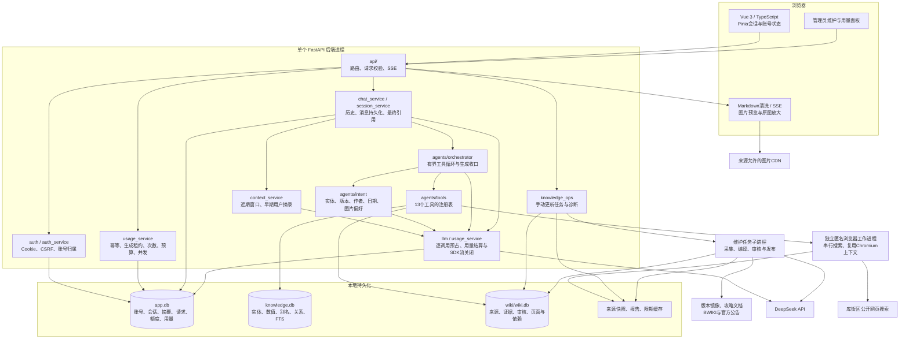
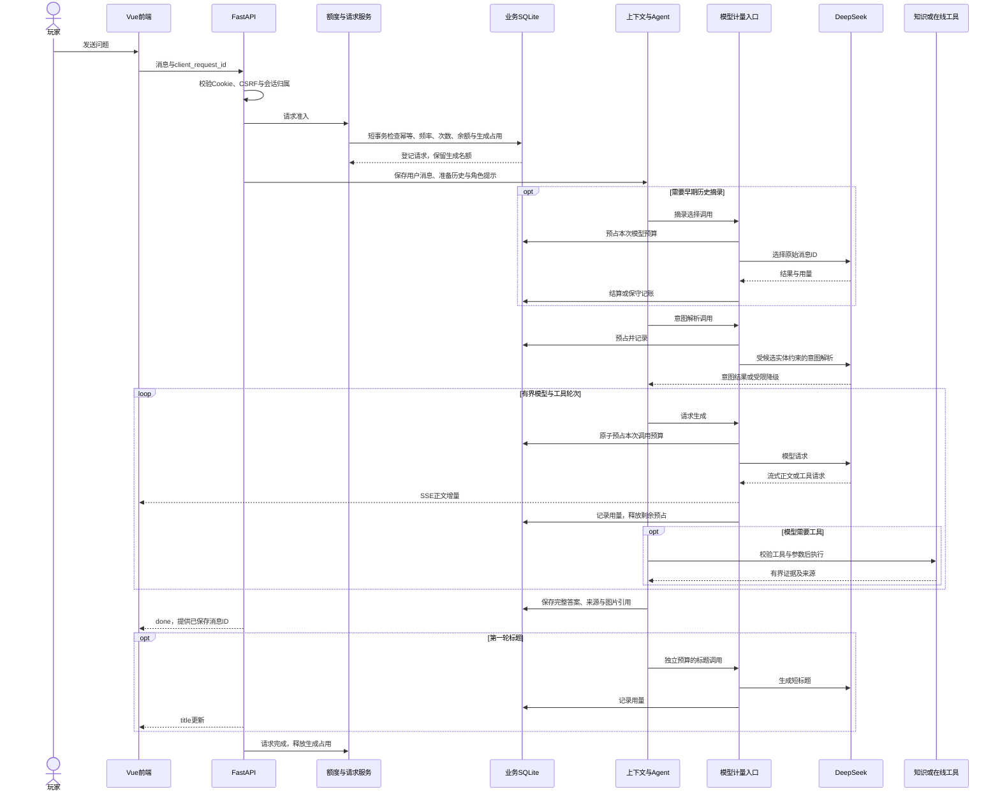

# 项目架构

本文描述当前 `v2/` 的实际实现。原 V1 蓝图已由此文替代；历史基础版本仍可通过 Git 标签 `v1.0` 查看。项目定位是单机、小范围分享的学习作品，当前没有 MySQL集群、Redis、向量库、JWT认证或多个独立智能体服务。

启动、配置、维护命令和已知限制统一见 [README](README.md)。

## 1. 分层与模块

浏览器只连接本站业务API及允许的图片资源，模型Key留在后端。所谓 Agent 是同一应用中的编排模块，不是部署了一组互相通信的模型服务。知识维护可启动独立任务子进程；网页查询使用独立浏览器子进程，两者用途不同。

## 2. 一轮聊天的时序

同请求ID重发不重复生成；已完成时可重放答案，进行中或失败状态通过请求状态和历史查询确认。SSE的每次生成器推进单独绑定计量上下文，避免跨线程恢复时混用账号。客户端停止后关闭上游流，未知用量保守记入；进程崩溃后的过期占用在启动检查或后续请求中回收。

## 3. 检索与工具边界

| 工具组 | 工具 | 数据与职责 |
| --- | --- | --- |
| 结构化知识（7） | `get_character_stats`、`get_character_profile`、`get_ascension_materials`、`search_knowledge_text`、`get_entity_relations`、`get_character_skills`、`get_knowledge_entity` | 确定性数值／字段查询、实体关联、全文与字面检索 |
| 已审核资料（3） | `search_wiki`、`search_documents`、`get_version_impact` | 机制、作者攻略、日期文档和公告关联的有界证据摘录 |
| 在线攻略（1） | `find_gameplay_guides` | 库街区公开文字预览、作者、时间和图片引用；未命中时可提供有日期限制的人工指定微博原帖入口；不解析视频或采集微博正文 |
| 通用示例（2） | `get_current_time`、`roll_dice` | 时间与随机工具，用于基础工具链路 |

意图解析负责选范围，工具负责返回证据，模型负责组织回答。数值查询与文档检索是并列通道；没有“语义分数达到阈值就直接从SQLite返回最终答案”的流程。

- 实体名称、ID与别名共同解析；漂泊者不同元素形态独立，玩家的对话身份不自动绑定形态。
- 版本、作者、日期、链数与关卡约束在执行层再次校验；明确只依据已收录攻略时，不改用档案或机制页补答。
- Wiki与文档采用FTS／关键词候选和字面补召回，评分不是语义概率；不包含embedding、rerank或图数据库。
- 工具结果与整轮上下文有预算，尽量保留完整结论和条件而非任意切断；不足时缩小范围或明确缺口。
- 正文与素材图区分。原图仅在确实取得关联引用后附加；截图内容没有经过OCR，不能当作模型已经阅读的事实。

## 4. LLM Wiki 的构建与更新

```mermaid
flowchart LR
    SRC["版本镜像 / 作者攻略<br/>BWIKI / 官方公告 / 文件"] --> COL["限频采集或本地导入"]
    COL --> REV["不可变来源修订<br/>日期、哈希、实体与版本"]
    REV --> PLAN["依赖检查与增量计划"]
    PLAN --> EVID["按主题与实体投影证据<br/>控制输入和章节规模"]
    EVID --> COMPILE["LLM编译草稿"]
    COMPILE --> LINT["引用定位、结构与数值校验"]
    LINT --> REVIEW["绑定草稿指纹的审核"]
    REVIEW --> PUB["发布有效章节"]
    PUB --> SEARCH["玩家只检索有效已审核页"]
    REV -. 来源改变 .-> INVALID["旧依赖页失效"]
    INVALID --> PLAN
```

LLM Wiki 把检索前的资料整理、引用和审核显式化。原文、来源修订和引用字典是证据基础，Wiki不是独立事实来源；自动审核也不能替代全部人工语义核对或实战验证。

在线聊天检索和图片解析使用只读Wiki连接，并校验已部署结构；来源哈希发生变化时拒绝旧证据，通过管理任务同步、编译和审核后再发布。在线请求不执行迁移或来源导入。返回结论必须带有效引用，来源修订失效的页面不参与检索。

mcguide平台更新时间、官方公告发布时间、游戏版本和玩法周期分开保存。每角色最新一篇作者攻略不等于已证明它适用于当前游戏版本。原文未标链数、动作顺序或能量前提时保持缺口，不由模型补成完整输出轴。

更新由管理员主动启动，可分批与恢复，保留报告和备份；不安装定时整站采集任务。来源变化使依赖失效，重新编译审核后再发布。聊天不会自动触发整库构建；编译子进程的模型费用不计入聊天额度账本。

## 5. 在线玩法与图片

在线查询默认按本地已审核的绝对时间匹配当期，不按帖子发布日期或固定天数推算。没有有效周期就不把旧图文认定为当期攻略。

工作进程复用匿名Chromium上下文，串行队列最多8个请求、等待锁最多80秒，单次浏览器工作请求75秒上限。至少间隔6秒，遵守更长站点规则和冷却；不使用用户浏览器登录态、不解验证码、不绕过403／429。模型调用或工具阻塞结束前，生成时限并非硬实时中断器。

| 缓存／状态 | 生命周期与约束 |
| --- | --- |
| 普通搜索元数据 | 内存5分钟、磁盘6小时；不包含用户问题或浏览器凭据 |
| 当期成功记录 | 最长24小时，绑定玩法、来源修订、文档版本、绝对周期与阶段 |
| 刷新失败兜底 | 仅普通网络故障、超时或冷却，仍需当期匹配及作者／版本／关卡筛选，并注明原采集时间 |
| 禁止兜底情形 | 跨期、记录超龄、周期失效、来源结构变化、访问限制、历史日期查询、管理员强制复查 |

图片由客户端加载来源CDN，使用受约束的压缩预览、懒加载、原图回退和手动重试。不会为在线帖子解析视频或把原图下载进公共知识库；用户最终回答中的图片引用仍保存在聊天历史。

## 6. 数据、事务与费用

业务库保存账号、登录态、消息、上下文摘要、生成请求、额度桶及模型调用账本；结构化知识库与Wiki独立。它们具有不同更新周期和恢复边界，不应把任何一个数据库当作另一个数据库的备份。

SQLite启用WAL、外键和锁等待。额度事务使用统一锁行检查与预占，网络等待不持有数据库写锁；租约与预算状态持久化，费用采用整数微元。原子性保证不依赖前端禁用按钮或进程内计数。

SSE响应显式管理同步生成器生命周期，并在断连时取消本轮、关闭已建立的模型流。清理后结算已知／未知用量并释放占用；完整回答落库后先记录请求对应的消息ID，断连不影响重放。非流式短调用及同步工具按返回／超时协作退出，不强杀工作线程，也不提前释放仍在执行的并发名额。

每次模型调用单独预占并结算，未知用量按预占保守记录，禁止把连接失败直接当零费用。日／月账本按北京时间划分；预算费率有版本，账本不保存提示正文或真实Key。模型供应商最终费用、知识库编译与其他脚本调用不由这个聊天账本完全控制。

## 7. 已实现与扩展边界

交付使用根目录 Dockerfile 多阶段构建与单服务 Compose：Node 编译前端，Python 锁文件安装服务依赖，镜像安装 Chromium 及系统库。运行服务以 UID/GID 10001 读取只读代码，SQLite、知识数据和任务报告绑定到宿主机数据目录；密钥只在启动时注入。原始镜像库通过显式路径配置映射，来源修订及哈希校验保留。Compose 仍保持单进程，不提供多副本共享浏览器、缓存或分布式锁。

公网部署提供宿主机 Nginx 模板：80 跳转 HTTPS，443 终止 TLS 后转发到 `127.0.0.1:8000`。Nginx 覆盖转发头、关闭 SSE 缓冲；Compose 通过 `APP_FORWARDED_ALLOW_IPS` 指定实际 Docker 网关，仅信任该代理来源以还原 HTTPS 与客户端 IP，供 Origin 校验和认证限流使用。域名、证书和网关需在服务器配置并验收；模板不包含 CDN 或多层代理链。

| 当前实现 | 后续按需求扩展 |
| --- | --- |
| 单机FastAPI、SQLite业务库 | MySQL真实集成与数据搬迁、多实例共享协调 |
| Cookie登录态、邮箱验证、CSRF | 找回密码、账号生命周期管理 |
| SQL／关键词／已审核Wiki | 经评测后再考虑embedding、rerank或向量库 |
| 数据库额度与生成占用 | 高频、多实例场景下的Redis计数或队列 |
| 手动维护、运行报告与Compose部署 | 真实就绪检查、定期备份、CI与发布回滚流程 |
| 会话级上下文 | 在有明确产品需求时再考虑跨会话记忆 |

当前优先保证小范围演示可运行、隔离正确、费用可控。迁移接口和模块边界已经保留，但未验证的部署能力不作为现有功能宣称。
